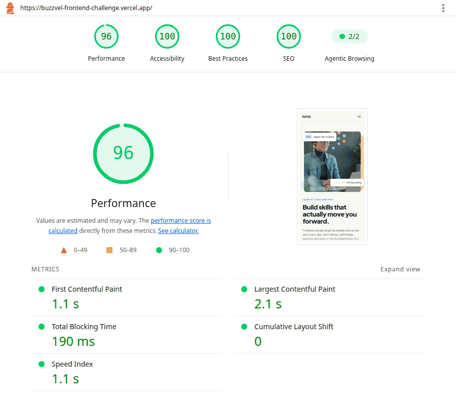

# Luma landing page

A responsive landing page for Luma, a fictional learning platform. Built from a Figma design for the Buzzvel front-end challenge.

**Live:** https://buzzvel-frontend-challenge.vercel.app

## Stack

- Next.js 16.4 (App Router)
- React 19
- TypeScript
- Tailwind CSS 4
- Storybook 10
- Vitest and Testing Library

## Getting started

Requires Node.js 24.15 or later. The version is pinned in `.nvmrc`.

```bash
nvm use
npm install
npm run dev          # http://localhost:3000
```

Production build:

```bash
npm run build
npm start            # http://localhost:3000
```

Tests and Storybook:

```bash
npm test
npm run storybook    # http://localhost:6006
```

Other checks: `npm run lint`, `npm run typecheck`, `npm run format:check`, `npm run build-storybook`.

## Project structure

```text
src/app          Page, layout, metadata, 404 page, /api/contact route
src/components   One folder per section, plus ui/ and icons/
src/data         Typed page content (mock data)
src/lib          Contact form validation, structured data
public           Images and icons exported from Figma
docs             Decision log, roadmap, Lighthouse screenshot
```

Stories and tests sit next to their component.

## Key decisions

Each decision is explained in [docs/decisions.md](docs/decisions.md).

- **Design tokens.** Figma colors and text styles are tokens in Tailwind's `@theme`. The default palette is removed, so only design colors exist. Token names are short roles like `ink` or `cream`. ([Design tokens](docs/decisions.md#design-tokens-2026-11-16))
- **Breakpoints.** Mobile is below 768px. Tablet is 768–1023px. Desktop starts at 1024px, where the type scale and the header navigation switch. The Hero only splits into two columns at 1280px. Below that, its badges would be clipped. ([Header](docs/decisions.md#header-2026-11-16), [Hero](docs/decisions.md#hero-2026-11-18))
- **Tablet layout.** Figma has no tablet frame. Most sections use the mobile layout in a centered 560px column. The category cards use two columns. ([Hero](docs/decisions.md#hero-2026-11-18), [Categories](docs/decisions.md#categories-2026-11-18))
- **Accessibility.** There is a skip link and one global focus ring. The mobile menu is a disclosure: Escape closes it and returns focus. Form errors are linked to their fields. Focus moves to the first invalid field. All motion respects `prefers-reduced-motion`. Buttons keep a visible edge in forced colors mode. ([Mobile menu](docs/decisions.md#mobile-menu-panel-2026-11-13), [Contact](docs/decisions.md#contact-2026-11-19), [Review](docs/decisions.md#review-2026-11-19))
- **Contact form.** It posts to a simulated route handler, `POST /api/contact`. The route waits 800ms and validates again on the server. It stores nothing. ([Contact](docs/decisions.md#contact-2026-11-19))
- **Community mosaic.** Photo sizes and gaps come from Figma. They are converted to `cqw` units of the mosaic container (container queries). The mosaic matches Figma at its design width and scales down on narrow screens. ([Community](docs/decisions.md#community-2026-11-19))
- **Images and fonts.** Every image uses `next/image` with `sizes` for its layout. The Hero photo is the LCP element. It loads eagerly with `fetchPriority="high"`, which I measured against `preload`. Fonts are self-hosted with `next/font`. ([Hero](docs/decisions.md#hero-2026-11-18), [Review](docs/decisions.md#review-2026-11-19))
- **Figma inconsistencies.** Some frames disagree. For example, all three desktop steps say "Step 01". The mobile form is in Portuguese. Container widths vary between 1120px and 1136px. Each case and its fix is listed. ([Figma inconsistencies](docs/decisions.md#figma-inconsistencies-2026-11-13))

## Performance and accessibility

Lighthouse 13.6 on the production site. Median of 3 runs.

| Device  | Performance | Accessibility | Best practices | SEO | LCP    | CLS | TBT    |
| ------- | ----------- | ------------- | -------------- | --- | ------ | --- | ------ |
| Mobile  | 96          | 100           | 100            | 100 | 2.14 s | 0   | 188 ms |
| Desktop | 100         | 100           | 100            | 100 | 0.52 s | 0   | 0 ms   |

These are lab numbers with simulated throttling. There is no field data from real users for this site.



## Known issues

- Some section heights differ from Figma by up to 9px. Desktop: Testimonial +9px. Mobile: How it works −9px, Featured course +6px, Categories +5px.
- A few interface strings live in components instead of `src/data`: "Explore", "Step", "with", "Menu", "Skip to content".
- Lighthouse flags render-blocking CSS (8.5 KB), legacy JavaScript (14 KB) and unused JavaScript (29 KB). They come from Next.js defaults.
- `npm audit` reports 11 moderate vulnerabilities. All of them are in development tools, with no fix available yet. `glob` and `minimatch` come from Storybook (`@storybook/nextjs-vite` through `@joshwooding/vite-plugin-react-docgen-typescript`). `typescript-eslint` comes from `eslint-config-next`. `npm audit --omit=dev` reports none.
- The contact form has no spam protection, such as a honeypot or rate limiting. There is no real backend to protect.
- Without JavaScript, the form still posts to `/api/contact`. The route expects JSON, so it answers with a 400 response.
- Login, sign-up, course, community and footer pages are out of scope. Their links open a custom 404 page that says so.
- Chromatic (visual tests for Storybook) is not set up.
- npm 11 warns that the esbuild postinstall script is not covered by allowScripts. Build, tests and Storybook work with this warning.

## Time spent

| Task                                    | Time        |
| --------------------------------------- | ----------- |
| Setup, Figma analysis and design tokens | ~6h         |
| Storybook and Vitest                    | ~0.5h       |
| Header and mobile menu                  | ~1.9h       |
| Page sections (Hero to Footer, 9 PRs)   | ~3.65h      |
| Metadata and 404 page                   | ~0.4h       |
| Review and fixes                        | ~0.85h      |
| README                                  | ~0.45h      |
| **Total**                               | **~13.75h** |

Details per task are in [docs/roadmap.md](docs/roadmap.md).

## How I used AI

I built this with Claude Code.

- **Rules.** [CLAUDE.md](CLAUDE.md) sets the code conventions, the git flow and the checks.
- **Process.** Each task started with a written plan. I approved the plan before any code. Each task had its own branch and PR. I approved every commit message.
- **Figma.** The Figma MCP server has a limit of 20 calls a month. Every response was cached locally. Images were downloaded once. The original file was view-only. The MCP server needs edit access, so I used a copy in my own drafts.
- **Checks.** Claude Code compared each section with the Figma screens at 402px and 1280px. It also checked 768px and 1024px. I reviewed the results and the screenshots. Lighthouse ran on the production site. axe ran on every Storybook story. Vitest tests cover the interactions. I approved every plan and every commit.
